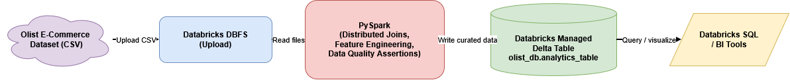

# Big Data E-Commerce Pipeline (PySpark + Delta Lake)

A distributed big data pipeline that processes messy e-commerce transaction data to calculate delivery metrics and optimize customer analytics. Built to simulate enterprise-scale data engineering workflows using Apache Spark and the Delta Lake architecture.

## Architecture

## Business Value
E-commerce platforms generate massive volumes of fragmented transactional data. This pipeline ingests raw CSV data, performs distributed joins across millions of records, engineers critical delivery time features, and enforces strict data quality checks before persisting the data in an ACID-compliant Delta Lake table for downstream BI reporting.

## 🛠️ Tech Stack
- **Compute**: Apache Spark (PySpark API)
- **Platform**: Databricks Community Edition
- **Storage**: Databricks Managed Metastore (Delta Lake format)
- **Data Quality**: Native PySpark Assertions
- **Version Control**: Git & GitHub

## Project Structure
.
├── notebooks/
│   └── Olist_Ecommerce_PySpark_Pipeline.ipynb  # Main transformation logic
├── architecture_pyspark.png                    # System design diagram
└── README.md                                   # Project documentation
